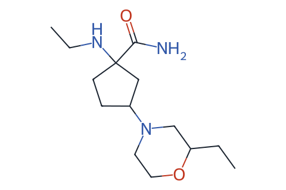
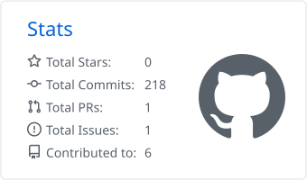
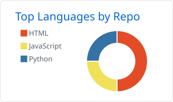

<!-- ===== ヘッダー：chemfig で描いた構造式が線画として描かれていく ===== -->
<picture>
  <source media="(prefers-color-scheme: dark)" srcset="assets/header-molecule-dark.svg">
  
</picture>

<!-- ===== タイピングアニメーション（lines は ; 区切り、+ は空白、%C3%97 は ×） ===== -->

<!-- ===== リンク ===== -->

---

<!-- ===== スタック（skillicons.dev の i= にアイコン ID をカンマ区切りで指定） ===== -->
### 🛠️ Stacks

<table>
  <tr>
    <td><b>Languages</b></td>
    <td></td>
  </tr>
  <tr>
    <td><b>Frameworks & DB</b></td>
    <td></td>
  </tr>
  <tr>
    <td><b>Tools</b></td>
    <td></td>
  </tr>
  <tr>
    <td><b>Chemistry</b></td>
    <td>
      
      
    </td>
  </tr>
  <tr>
    <td><b>Lab</b></td>
    <!-- shields のラベルでは _ が空白、-- が - として表示される -->
    <td>
      
      
      
    </td>
  </tr>
</table>

<!-- ===== プロジェクト ===== -->
### 🚀 Projects

| Project                                                                   | Description                                              | Tech                                          |
| ------------------------------------------------------------------------- | -------------------------------------------------------- | --------------------------------------------- |
| [**synth-eln**](https://github.com/Holy-Negi/synth-eln)                   | 化学物性値計算・自動当量表生成機能を有した電子実験ノート | Python · FastAPI · PostgreSQL · React · RDKit |
| [**Structure_Exporter**](https://github.com/Holy-Negi/Structure_Exporter) | ChemDraw の選択範囲を SVG / PNG で書き出すアドイン       | ChemDraw · JavaScript                         |
| **latex-for-chemists**                                                    | 🚧 Coming soon...                                         | LaTeX                                         |

<!-- ===== 以下の自動更新セクションは、マーカーの間を Actions が毎日書き換えます ===== -->
### ✍️ Latest articles

<!-- ARTICLES:START -->
- [chemfigで化学構造式をACS Styleで描画する](https://qiita.com/Holy_/items/15f0140aac99b37ff8a5)   2026-10-11
- [YAMLをコマンドラインで検索・抽出・編集できるyqコマンドの使い方](https://qiita.com/Holy_/items/c6e356e3df48c1f6a154)  2026-09-20
- [CSVをSQLデータベースのように扱えるqコマンドの使い方](https://qiita.com/Holy_/items/74250810cc9a75584e74)  2026-08-20
- [はじめまして](https://zenn.dev/nekiroh/articles/1bc7a54d0c3320)  2026-08-15
- [LaTeXにChemDrawで描画した化学構造式をシームレスに挿入する](https://qiita.com/Holy_/items/2689228f35d6cd10497b)  2026-02-11
<!-- ARTICLES:END -->

### 📡 Recent activities

<!-- ACTIVITY:START -->
- [`lecture-ai-engineering-2026`](https://github.com/Holy-Negi/lecture-ai-engineering-2026) — `Codespaces の環境定義（.devcontainer）と .gitignore を追加` (4日前)
- [`synth-eln`](https://github.com/Holy-Negi/synth-eln) — `feat: add some features` (11日前)
- [`portfolio`](https://github.com/Holy-Negi/portfolio) — `add some skills to skillsets` (11日前)
- [`holy-negi`](https://github.com/Holy-Negi/holy-negi) — `fix: include CID in molecule SVG filenames to bust image cache` (11日前)

最終更新: 2026-10-29 10:02 JST
<!-- ACTIVITY:END -->

### ⚗️ Molecule of the Day

<!-- MOLECULE:START -->

<picture>
  <source media="(prefers-color-scheme: dark)" srcset="assets/molecule/79655263-dark.svg">
  
</picture>
 
<b><a href="https://pubchem.ncbi.nlm.nih.gov/compound/79655263">1-(Ethylamino)-3-(2-ethylmorpholin-4-yl)cyclopentane-1-carboxamide</a></b> 
C14H27N3O2 · 269.38 g/mol · CID 79655263 
Randomly picked from PubChem on 2026-10-29

<!-- MOLECULE:END -->

<!-- ===== 統計 ===== -->
### 📊 Stats

<picture>
  <source media="(prefers-color-scheme: dark)" srcset="profile-summary-card-output/github_dark/3-stats.svg">
  
</picture>
<picture>
  <source media="(prefers-color-scheme: dark)" srcset="profile-summary-card-output/github_dark/1-repos-per-language.svg">
  
</picture>

<picture>
  <source media="(prefers-color-scheme: dark)" srcset="https://raw.githubusercontent.com/Holy-Negi/holy-negi/output/snake-dark.svg">
  
</picture>

